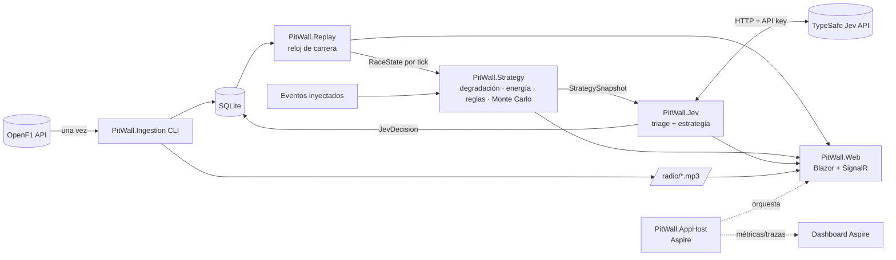
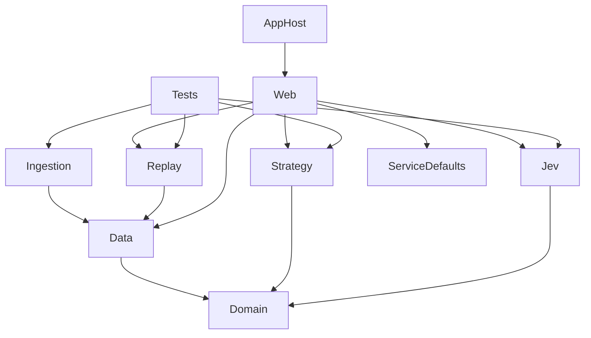

# Arquitectura

## 1. Vista general



Principio: **la carrera es real, la decisión es calculada**. El replay nunca se modifica; estrategia y Jev son capas que observan el estado y producen decisiones.

## 2. Proyectos

```
PitWall.sln
├─ src/
│  ├─ PitWall.AppHost          Aspire: orquesta Web, parámetros (API key), dashboard
│  ├─ PitWall.ServiceDefaults  OpenTelemetry, health checks, resiliencia HTTP
│  ├─ PitWall.Domain           Modelos, enums, contrato Jev. Sin dependencias.
│  ├─ PitWall.Data             EF Core SQLite: DbContext, entidades, migraciones
│  ├─ PitWall.Ingestion        CLI: OpenF1 → SQLite + mp3
│  ├─ PitWall.Replay           Reloj de carrera, construcción de RaceState
│  ├─ PitWall.Strategy         Degradación, energía, reglas, Monte Carlo
│  ├─ PitWall.Jev              IJevClient, JevClient, FakeJevClient, caché, guardas
│  └─ PitWall.Web              Blazor Interactive Server, paneles
└─ tests/
   └─ PitWall.Tests            xUnit
```

### Dependencias permitidas



Reglas:
- `Domain` no referencia nada.
- `Strategy` y `Jev` no conocen EF Core ni Blazor → testeables puros.
- Persistencia de Jev (`JevCache`, `JevDecisionLog`) y de escenarios (`Scenario`, `InjectedEvent`): el proyecto que la necesita (`Jev`, `Strategy`) define una interfaz de almacenamiento sin EF Core; `Web` la implementa con `Data` y la registra en DI.
- `Tests → Replay` habilita los tests de integración del replay ([testing.md](testing.md) §1).
- `Web` es el único host de ejecución en la demo; Replay/Strategy/Jev corren como `BackgroundService` dentro de él.
- `Ingestion` es un ejecutable aparte (se corre antes de la charla).

## 3. Flujo en runtime

1. `ReplayClock` avanza el tiempo virtual según velocidad.
2. `RaceStateBuilder` arma `RaceState` (posiciones, gaps, stints, clima, race control) para el instante actual leyendo SQLite (cacheado en memoria al iniciar la sesión).
3. Al **cerrarse una vuelta** del piloto, `StrategyWorker` calcula por cada uno de los 4 pilotos:
   - degradación + vida restante,
   - energía estimada,
   - reglas → restricciones + `reasons`,
   - Monte Carlo → `StrategyOutcome[]`.
4. `JevWorker` decide si disparar según `Jev:Mode`:
   - **Triage**: ante nuevo mensaje de Race Control o evento inyectado.
   - **Estrategia**: si triage = `ACT_NOW`, o modo `EveryLap`, `SpecificLaps` o botón `Manual`.
5. Resultado → `JevDecision` persistida y publicada.
6. `PitWallHub` (SignalR) empuja deltas a los paneles.

### Comunicación interna

- `System.Threading.Channels` entre workers (productor/consumidor, sin brokers externos).
- Un `RaceSessionState` singleton por sesión activa con el último snapshot por piloto → cambio de piloto instantáneo (RF-03).

## 4. Modelos de dominio clave

```csharp
// Instantánea del estado de carrera en un tick del replay
record RaceState(int SessionKey, DateTimeOffset Clock, int LeaderLap,
                 IReadOnlyList<CarState> Cars, WeatherState Weather,
                 TrackStatus Track, IReadOnlyList<RaceControlMessage> NewMessages);

// Estado de un auto
record CarState(int DriverNumber, int Position, int Lap, double? GapToLeader,
                double? Interval, Compound Compound, int TyreAge, bool InPit);

// Resultado de estrategia por piloto y vuelta (input de Jev)
record StrategySnapshot(int DriverNumber, int Lap, TyreModel Tyre, EnergyEstimate Energy,
                        IReadOnlyList<StrategyOutcome> Outcomes, IReadOnlyList<Reason> Reasons,
                        IReadOnlyList<Constraint> Constraints);

// Decisión final de Jev (contrato público)
record JevDecision(...); // ver jev.md
```

## 5. Observabilidad (Aspire)

| Métrica | Tipo |
|---|---|
| `pitwall.jev.requests` | counter (tags: `kind=triage|strategy`, `client=real|fake`, `cache=hit|miss`) |
| `pitwall.jev.tokens` | counter |
| `pitwall.jev.latency` | histogram (ms) |
| `pitwall.jev.cost_usd` | counter (estimado) |
| `pitwall.montecarlo.duration` | histogram (ms) |
| `pitwall.replay.lap` | gauge |

Trazas: una `Activity` por decisión que abarca `Strategy → Jev → Publish`. En la charla se muestra la latencia de cada decisión en el dashboard.
