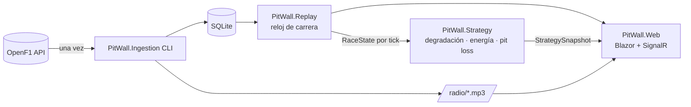
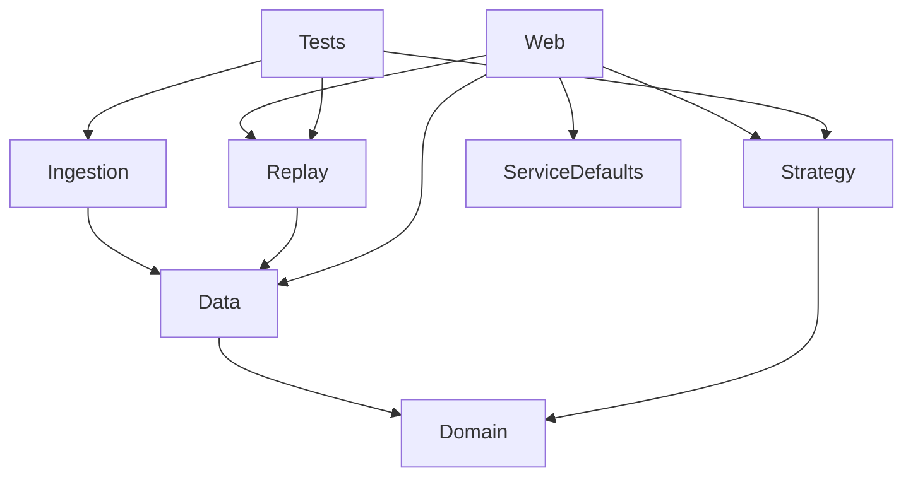

# Arquitectura

## 1. Vista general



Principio: **la carrera es real, la estrategia es calculada**. El replay nunca se modifica; la estrategia es una capa que observa el estado real y calcula gomas, energía y la llamada a boxes.

## 2. Proyectos

```
PitWall.sln
├─ src/
│  ├─ PitWall.ServiceDefaults  OpenTelemetry, health checks, resiliencia HTTP
│  ├─ PitWall.Domain           Modelos y enums del contrato público. Sin dependencias.
│  ├─ PitWall.Data             EF Core SQLite: DbContext, entidades, migraciones
│  ├─ PitWall.Ingestion        CLI: OpenF1 → SQLite + mp3
│  ├─ PitWall.Replay           Reloj de carrera, construcción de RaceState
│  ├─ PitWall.Strategy         Degradación, energía, llamada a boxes
│  └─ PitWall.Web              Blazor Interactive Server, paneles
└─ tests/
   └─ PitWall.Tests            xUnit
```

### Dependencias permitidas



Reglas:
- `Domain` no referencia nada.
- `Strategy` no conoce EF Core ni Blazor → testeable puro.
- `Tests → Replay` habilita los tests de integración del replay ([testing.md](testing.md) §1).
- `Web` es el único host de ejecución en la demo; Replay/Strategy corren como `BackgroundService` dentro de él.
- `Ingestion` es un ejecutable aparte (se corre antes de la charla).

## 3. Flujo en runtime

1. `ReplayClock` avanza el tiempo virtual según velocidad.
2. `RaceStateBuilder` arma `RaceState` (posiciones, gaps, stints, clima, race control) para el instante actual leyendo SQLite (cacheado en memoria al iniciar la sesión).
3. Al **cerrarse una vuelta** del piloto, `StrategyWorker` calcula por cada uno de los 4 pilotos:
   - degradación + vida restante,
   - energía estimada,
   - pit loss de la sesión.
4. `PitWallHub` (SignalR) empuja deltas a los paneles.

### Comunicación interna

- `System.Threading.Channels` entre workers (productor/consumidor, sin brokers externos).
- Un `RaceSessionState` singleton por sesión activa con el último snapshot por piloto → cambio de piloto instantáneo (RF-03).

## 4. Modelos de dominio clave

```csharp
// Instantánea del estado de carrera en un tick del replay
record RaceState(int SessionKey, DateTimeOffset Clock, int LeaderLap,
                 IReadOnlyList<CarState> Cars, WeatherState Weather,
                 TrackStatus Track, IReadOnlyList<RaceControlMessage> NewMessages);

// Estado de un auto
record CarState(int DriverNumber, int Position, int Lap, double? GapToLeader,
                double? Interval, Compound Compound, int TyreAge, bool InPit);

// Resultado de estrategia por piloto y vuelta
record StrategySnapshot(int DriverNumber, int Lap, TyreModel Tyre, EnergyEstimate Energy)
{
    double? PitLossSeconds { get; init; }  // pit loss medio de la llamada a boxes
}
```

## 5. Observabilidad (OpenTelemetry)

Se exportan por OTLP solo si está definida `OTEL_EXPORTER_OTLP_ENDPOINT`; si no, se pueden ver con `dotnet-counters monitor`.

| Métrica | Tipo |
|---|---|
| `pitwall.replay.lap` | gauge |

Trazas: una `Activity` por cálculo que abarca `Strategy → Publish`.
